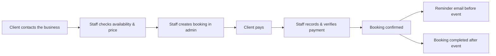

# Icon Venue & Suites — User Guide

This guide explains how the booking system works for **clients**, **staff**, and **administrators**. It focuses on everyday workflows — browsing, booking, payments, and reports — not technical setup.

---

## Who Uses This System?

| Role | Who they are | What they do |
|------|----------------|--------------|
| **Client** | Guests and event organisers | Contact the business by phone, email or social media to book; they don't use the app |
| **Staff** | Front-desk or operations team | Create bookings, record payments, verify payments, manage clients |
| **Admin** | Business owner or manager | Everything staff can do, plus venues, suites, packages, add-ons, staff accounts, settings, and reports |

**Staff and admin** log in at `/login`; opening the app's home page shows the same sign-in page. Clients don't use the app.

---

## High-Level Overview

---

## Part 1 — Clients

Clients do **not** use the app. There is no public website: opening the app shows the staff **sign-in** page.

Clients contact the business by phone, email or social media to ask about availability and prices. Staff check the
admin **Calendar** and create the booking for them (Part 2). Clients receive booking, payment and reminder emails
when staff enter their email.

---

## Part 2 — Staff Flow (Admin Panel)

Staff log in and use the left sidebar for daily operations.

### Dashboard

Shows a quick overview of bookings, revenue, and recent activity.

### Create a booking

**Path:** New Booking (or Book from a venue listing)

1. **Select venue or suite**
   - Filter by Venues, Suites, or All
   - For **venues**: choose Full Day or specific time slots (and optional package)
   - For **suites**: standard stay is check-in 2:00 PM, check-out 12:00 PM next day; set number of days if needed
   - For **suites**, choose the **Rate**: *Regular rate* (walk-in / direct) or the booking platform the guest booked through (e.g. Agoda, Booking.com). Each option shows its nightly price for the selected room. The price uses that platform's rate for the room; if the room has no rate for that platform, the regular rate is used and the form says so. Optionally enter the **Platform reference** (the platform's booking ID). Discounts still apply on top.
2. **Enter client details** — name and phone (required), email (optional — without it the client gets no confirmation, payment or reminder emails)
3. **Set booking date** and duration
4. **Add add-ons** if applicable
5. **Apply discount** (optional) — amount or percentage with reason
6. **Review total** and submit

**After creation:**

- Booking status starts as **Pending**
- Payment status starts as **Unpaid**
- A unique **booking reference** is generated automatically
- Client may receive a booking confirmation email

### Manage bookings

**Path:** Bookings

| Action | When to use |
|--------|-------------|
| **View** | See full booking details, payments, and reference |
| **Edit** | Change date, slots, client info, or amounts (before/during coordination) |
| **Confirm** | Manually confirm when appropriate |
| **Cancel** | Client cancels or event is called off |
| **Complete** | Event or stay has finished |

**Calendar view** shows all bookings on a timeline. You can export calendar data to CSV.

### Record a payment

**Path:** Booking detail → Add Payment, or Payments → from booking list

1. Choose **Full Payment** or **Partial Payment**
   - **Full Payment** — pays the remaining balance; auto-verified for walk-in/cash scenarios
   - **Partial Payment** — custom amount; stays **Pending** until verified
2. Enter **amount**, **payment method**, and **reference number** (transaction ID, receipt no., etc.)
3. Optionally upload **proof of payment** (screenshot or receipt image)
4. Add **notes** if needed

### Verify or reject a payment

**Path:** Payments, or Payment Records on the booking page

**Before verifying**, review:

- Payment amount
- Payment method
- **Reference number** (shown on screen)
- Proof image (if uploaded)

| Status | Meaning |
|--------|---------|
| **Pending** | Recorded but not yet approved |
| **Verified** | Payment accepted; counts toward booking balance |
| **Rejected** | Payment declined (reason stored in notes); can be deleted |

**Verify** when the payment is confirmed in your bank, GCash, or other channel.

**Reject** if the proof is invalid or amount does not match — add a clear reason; the client may be notified by email.

When **verified payments** cover the full booking amount:

- Payment status → **Paid**
- Booking status → **Confirmed**

Partial verified payments set payment status to **Partial** until the balance is cleared.

### Manage clients

**Path:** Clients

- View all clients grouped by email (clients without an email are grouped by phone and marked "No email")
- See their booking history and contact details
- Update client information

### Browse venues & suites (staff)

Staff can toggle **availability** (active/inactive) for venues, suites, and packages without editing full venue settings.

---

## Part 3 — Admin Flow (Additional Features)

Admins have access to everything staff has, plus:

### Venues & suites

- Create and edit venues and suites (name, capacity, description, images, amenities)
- Set **Full Day Price** and **time-slot prices** separately
- Set each suite's **Regular rate (per night)**
- See **Room Rates** below to change suite prices.
- Manage **event packages** per venue (pricing, inclusions, time-based package rates)
- Toggle availability

### Room Rates

**Path:** Room Rates (admin only)

One screen with every suite (rows) and its **Regular** rate plus one column per booking platform (Agoda, Booking.com, …). Use it whenever management changes prices, for example for a promo.

1. Type the new prices straight into the cells. Changed cells turn yellow; hover to see the old price.
2. To give several rooms the same change, tick the rooms, pick the column and an action (**Set to ₱**, raise/lower by **₱** or **%**) and press **Apply**. This only fills the cells.
3. Press **Save changes** to save everything at once, or **Discard** to undo your edits. Nothing is saved until you press Save.

- An **empty platform cell** means that room uses its regular rate on that platform (the regular price is shown in grey). Clear a cell to go back to the regular rate.
- The regular rate can't be empty.
- New prices apply to **new bookings only**; existing bookings keep the rate they were booked at.
- **Manage platforms** (top right) opens the platform list.

### Booking platforms

**Path:** Room Rates → Manage platforms (admin only)

- Agoda and Booking.com are set up by default
- Add new platforms (e.g. Expedia), rename them, or change their display order
- **Deactivate** a platform to stop staff from selecting it for new bookings; a platform already used by bookings cannot be deleted

### Add-ons

- Create add-ons linked to venues (price, description, stock tracking)
- Enable or disable add-ons

### Staff accounts

- Add staff users with login credentials
- Activate or deactivate accounts

### Settings

- Business contact info (phone, email, WhatsApp, social links, booking form URL)
- Information shown on the public contact page and booking messages

### Carousel

- Manage homepage slideshow images

### Reports

**Path:** Reports

- Filter by **date range**
- View booking statistics, revenue, top venues/suites, and payment records
- **By Booking Platform**: bookings, booked total and verified revenue per rate source (Regular, Agoda, Booking.com, …)
- **Export to Excel** (CSV) — includes booking details, amounts, **rate / platform**, rate per night, platform reference, payment methods, and **reference numbers**

---

## Booking & Payment Status Reference

### Booking status

| Status | Meaning |
|--------|---------|
| **Pending** | Booking created; awaiting full payment or confirmation |
| **Confirmed** | Fully paid (or manually confirmed) |
| **Cancelled** | Booking cancelled |
| **Completed** | Event or stay has ended |

### Payment status

| Status | Meaning |
|--------|---------|
| **Unpaid** | No verified payments yet |
| **Partial** | Some payment verified; balance remains |
| **Paid** | Full amount verified |

---

## Typical End-to-End Example

### Venue event (wedding)

1. **Client** calls or messages the business asking for a Full Day wedding with add-ons → **Staff** checks the calendar
2. **Staff** creates booking with client details, wedding package, and add-ons
3. **Client** sends down payment via GCash
4. **Staff** records partial payment with reference number → verifies after checking account
5. **Client** pays balance before the event
6. **Staff** records and verifies final payment → booking becomes **Confirmed**
7. System sends **reminder email** 24 hours before the date
8. After the event, staff marks booking **Completed**

### Suite overnight stay

1. **Client** views suite → selects dates → contacts the business
2. **Staff** creates suite booking (multi-day if needed)
3. **Staff** records full payment (cash walk-in) → auto-verified
4. Booking is **Confirmed** immediately
5. After check-out, staff marks **Completed**

---

## Email Notifications

Clients may receive emails for:

- New or updated **booking status**
- **Payment verified** or **payment rejected**
- **Booking reminder** (about 24 hours before the event)

Ensure client email addresses are correct when creating bookings. If a booking has no email, no client emails are sent and the booking details show a **No email** badge.

---

## Quick Tips

**For clients**

- Keep your **booking reference** handy when paying or following up
- Send payment proof with the same reference number staff will record

**For staff**

- Always enter the **reference number** when recording payments — it appears before verification and in exported reports
- Use **Full Payment** for on-the-spot cash settlements
- Use **Partial Payment** for installments; verify each one separately
- Check the Payments list daily for pending items

**For admins**

- Set full-day and time-slot prices independently when editing venues
- Review **Reports** monthly and export to Excel for accounting
- Contact settings and carousel images are only shown on the public website, which is turned off for now

---

## Getting Help

- **Public website:** Use the Contact page for business inquiries
- **Admin panel:** Contact your system administrator for login or access issues
- **Technical setup:** See [README.md](README.md) for installation and developer documentation

---

*Icon Venue & Suites Booking System — User Guide*
